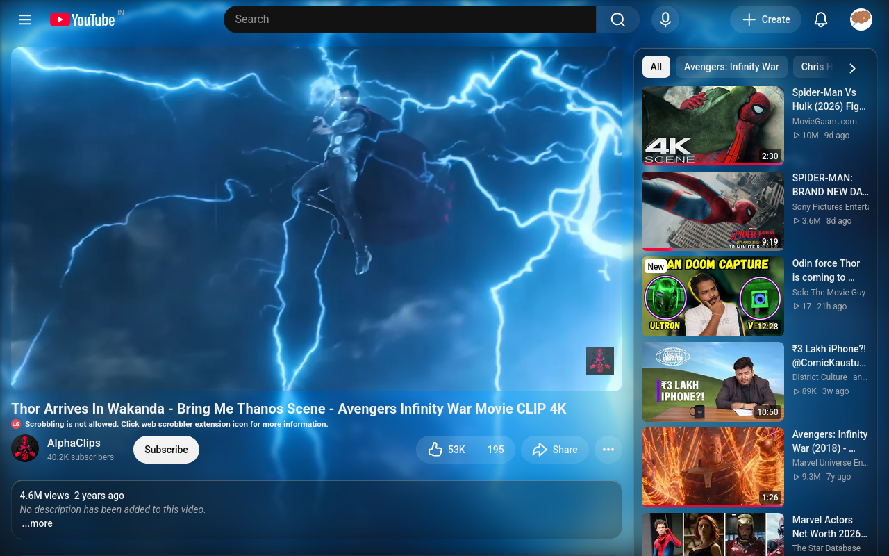
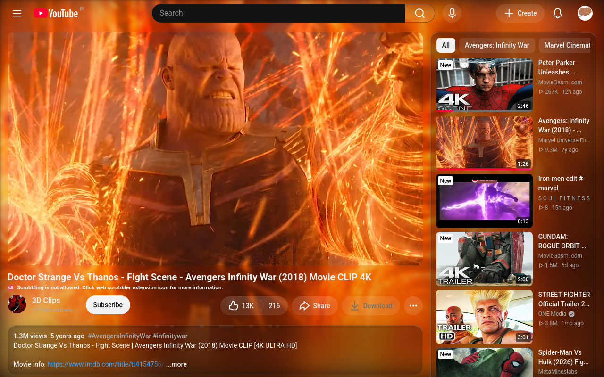
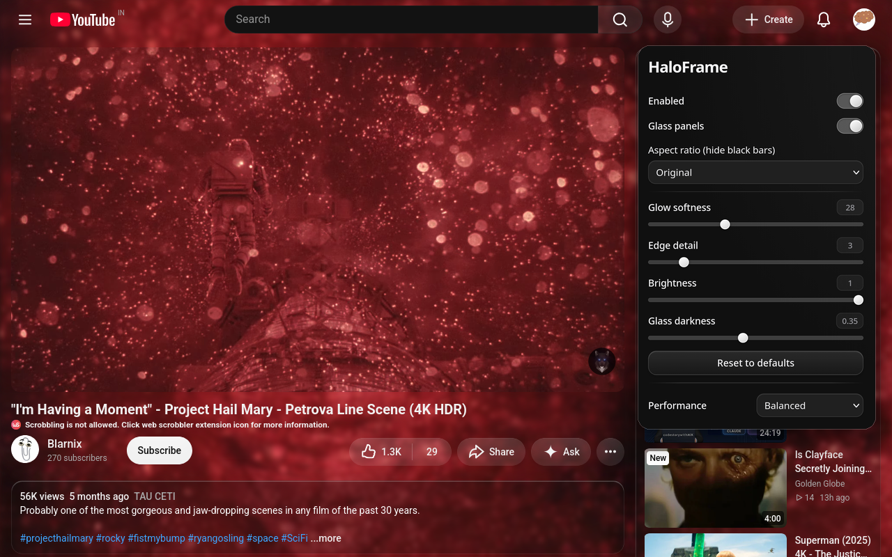

# HaloFrame


## Extends YouTube's video into the empty space around it
HaloFrame is a **browser extension that mirrors the actual picture outward and melts it into the page**, instead of averaging the frame into a flat color glow like YouTube's built-in ambient mode. Recommendations, description, and comments sit on **frosted glass panels** over the extended picture.

---

## Screenshots



<p>
  
  
</p>

---

## Features

- **Edge extension:** the video continues past its borders as mirrored, progressively blurred picture, not a flat color wash
- **Glass panels:** recommendations, description, and comments become translucent panels over the glow
- **Aspect ratio and black bars:** pick 2.39:1, 2:1, 1.85:1, or 4:3, or let HaloFrame detect and hide black bars automatically. The video zooms to fill the player and the glow follows only the visible picture
- **Live settings:** glow softness, edge detail, brightness, and glass darkness, all adjustable from the popup without reloading
- **Performance presets:** Quality, Balanced, and Battery saver control frame rate and resolution
- **Stays out of the way:** only runs on watch pages and replaces YouTube's own ambient layer instead of fighting it

---

## Install

HaloFrame isn't in the stores yet, so for now load it from source.

**Firefox / Zen**

1. Clone this repo
2. Open `about:debugging#/runtime/this-firefox`
3. Click "Load Temporary Add-on" and pick `manifest.json`

Temporary add-ons are removed when the browser restarts.

**Chrome / Edge**

1. Clone this repo
2. Open `chrome://extensions` (or `edge://extensions`) and turn on Developer mode
3. Click "Load unpacked" and pick the repo folder

---

## Usage

Open any YouTube video, then click the HaloFrame icon in the toolbar to open settings. If you don't see it, pin it from the browser's extensions menu.

To get rid of black bars, open the **Aspect ratio** dropdown and choose **Hide black bars** (automatic) or a fixed ratio that matches the video.

---

## How it works

1. A content script copies the current video frame into a small hidden canvas
2. That frame is tiled around the player with alternating mirror flips, so neighboring edges match with no seams
3. Two blurred layers are stacked: a heavy one for soft color and a light one next to the player, faded out with a radial mask, so detail dissolves with distance
4. YouTube's page backgrounds are made transparent so the layers show through
5. When an aspect ratio is chosen, the video is scaled until the real picture covers the player, and only the visible part of the frame is used for the glow

Settings are stored with `storage.local` and applied through CSS variables, so changes show up instantly.

---

## Project structure

```
manifest.json
icons/            extension icons
scripts/          build script for the Firefox and Chrome packages
src/content.js    rendering and page integration
src/settings.js   shared defaults
src/popup/        settings popup
```

---

## Known limitations

- YouTube changes its page structure from time to time. All selectors live in the `YT` object in `src/content.js`, so fixes are usually one line.
- Only runs on `www.youtube.com`.
- Hiding black bars zooms the video, so subtitles burned into the bars are cropped. YouTube's own captions are not affected.
- In theater mode, the zoom fills the whole player, so slightly more of the picture is cropped.